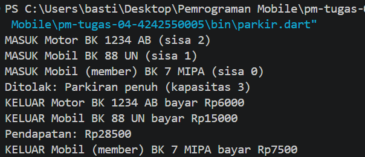

# Sistem Parkir Kampus (Console)

Tugas Rutin 4 - Pemrograman Mobile (3KOM40215)

## Identitas
- **Nama:** Sebastian Saut Marulitua Sinaga
- **NIM:** 4242550005
- **Kelas:** PSIK 24D

## Cara Menjalankan
```bash
dart run bin/parkir.dart
```

## Diagram Kelas
(ss/diagram.png)

## Tangkapan Layar Keluaran


## Penjelasan

Enkapsulasi saya terapkan di class `Parkiran`. Daftar kendaraan (`_terparkir`),
`_pendapatan`, dan `_kejadian` dibuat privat dengan awalan garis bawah,
sehingga hanya bisa diubah lewat method `masuk` dan `keluar`. Pihak luar hanya
membaca lewat getter `sisa`, `pendapatan`, dan `kejadian`.

Polimorfisme muncul pada `List<Kendaraan>` di `main`: Motor, Mobil,
MobilMember, dan Truk diperlakukan sama, tetapi `biaya` memakai `tarifPerJam`
milik masing-masing subclass. Mixin `Berlangganan` menimpa `biaya` untuk
memberi diskon 50% pada `MobilMember`.

Async dipakai pada `masuk` dan `keluar`. Keduanya mengembalikan `Future` dan
mensimulasikan palang dengan `Future.delayed`, lalu dipanggil dengan `await`
di `main`. Setiap kejadian dikirim ke `StreamController.broadcast()` dan
ditampilkan oleh listener. Kapasitas penuh ditangani dengan exception
`ParkirPenuh` yang ditangkap di `main`.

## Pernyataan Penggunaan AI

Saya menggunakan AI sebagai asisten belajar untuk membaca
spesifikasi tugas, menyusun kerangka kode, dan memahami konsep mixin, Future,
dan Stream. Kode saya jalankan sendiri di VS Code, saya uji dengan mengubah
beberapa nilai (kapasitas dan lama parkir), dan saya periksa dengan
`dart analyze`. Penjelasan di README ini saya tulis berdasarkan pemahaman
saya terhadap kode tersebut.